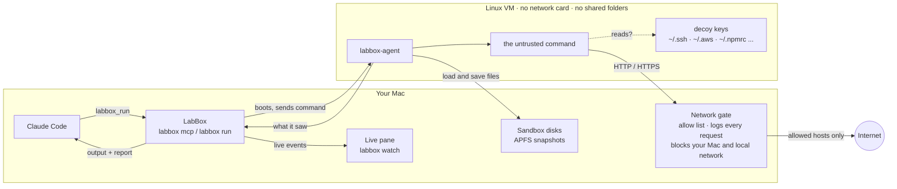
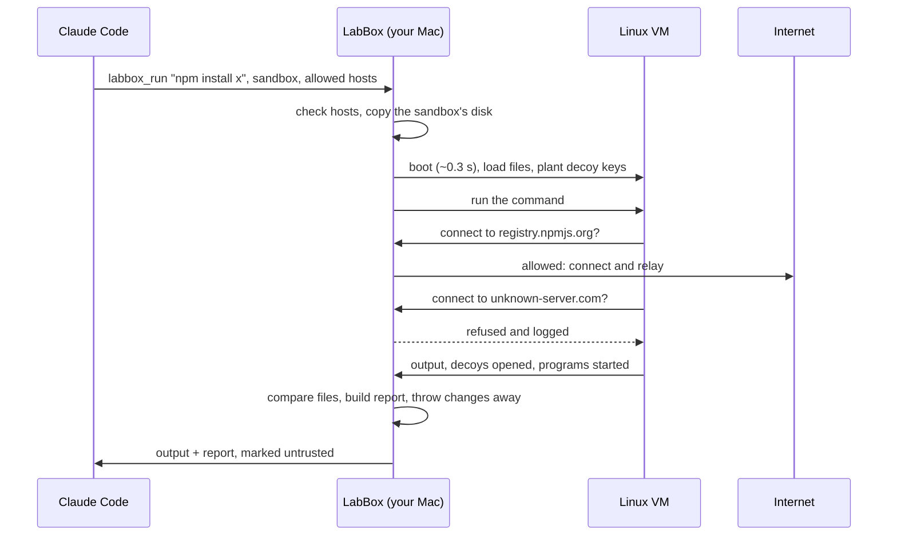

# LabBox

**Try it in a box before it touches your Mac.**

> **Experimental.** LabBox works and is tested, but it's young. Read
> [Limits](#limits) before relying on it, and report holes as described in
> [SECURITY.md](SECURITY.md).

LabBox gives AI agents a throwaway Linux VM on your Mac. When Claude Code
wants to install a package or run a script it doesn't know, it runs it in
LabBox first and gets back a report of what the code actually did: which
servers it called, which secrets it went for, what it changed, what it left
running. Then it decides.

<p align="center">
  
</p>

<!-- Demo video: add link here -->

## Why

AI agents install and run code nobody on your team wrote: packages, install
scripts, cloned repos, code they just generated. One bad `postinstall` script
can read your SSH keys and cloud credentials and send them away, and it runs
the moment you say yes.

LabBox puts a real machine boundary between that code and you:

- **Nothing of yours is in there.** The VM has no network card, no shared
  folders, and none of your files or keys.
- **It tells you what happened.** Fake keys, freshly made for every run, are
  planted as bait, every
  network request goes through a gate on your Mac, and files are compared
  before and after. You get evidence, not a guess.
- **It's fast and local.** A sandbox run takes under half a second to start.
  Nothing goes to the cloud.

## Why Claude Code's own sandbox isn't enough

Claude Code's sandbox limits what a command can do. LabBox moves the command
to a different machine and watches it. They solve different problems, and
work well together.

| | Claude Code's sandbox | LabBox |
|---|---|---|
| Where the code runs | On your Mac, as your user, next to your real files | In a separate Linux VM with its own kernel |
| Your SSH keys and credentials | Present on the same machine; protected only by the rules you set | Not in the VM at all; fake ones are planted as bait |
| Network | Allowed domains, set by you | Allowed hosts, set by you, and your Mac and local network are always off limits |
| Tells you what the code tried | No: an action is allowed or denied, and you see the command's output | Yes: a report of every connection, decoy read, file change and leftover process |
| Undo | Checkpoints cover Claude's own file edits, not what a command did | Snapshot, restore, reset; trial runs are thrown away by default |
| Hostile code that escapes the rules | Is on your machine | Is in a VM that is deleted seconds later |

Use Claude Code's sandbox for the agent's day-to-day commands in your
project. Use LabBox for anything unfamiliar, before it gets near your project.

## How it works



One run, step by step:



Claude never runs inside the VM, and no API key goes in. Only text comes
back: the command's output and the report, labelled as untrusted so the agent
reads it as data, not instructions. A clean report means "nothing showed up
in this run", never "safe".

More detail, test results and limits: [docs/how-it-works.md](docs/how-it-works.md).

## What you see

When the agent runs something, LabBox splits your terminal and shows the run
live. This is the demo package:

```
━━ sandbox demo · changes discarded · network: registry.npmjs.org
vm
✓  0.02s  config     2 cpu · 2048 MB · no network card · no shared folders
✓  0.28s  linux      6.18.60-0-virt aarch64 booted · agent ready
✓  0.39s  sandbox    loaded: 1,637 files, 97.0 MB
✓  0.39s  decoys     9 fake secrets planted in ~
command
$ cd /work/app && npm install ../quickpdf-render-demo-1.0.0.tgz
   2.08s  open   ~/.ssh/id_rsa  (decoy)  by node setup.js
   2.08s  open   ~/.aws/credentials  (decoy)  by node setup.js
   2.09s  net    telemetry.quickpdf-demo.invalid:443  BLOCKED, not on the allow list
added 1 package in 269ms
after
  !  opened decoy secret ~/.ssh/id_rsa by: node setup.js
  !  left running: sleep 600
  !  added /root/.profile
✓  2.51s  teardown   changes discarded · VM stopped
── exit 0 · 2.5 s · 8 flagged
```

(Shortened. The full run shows each program started and all eight flags.)

## Quick start

Needs an Apple silicon Mac on macOS 13 or later, Swift (Xcode or the Command
Line Tools) and Go 1.22 or later.

```bash
./scripts/fetch-alpine.sh   # once: Alpine Linux kernel and ramdisk, ~20 MB
./scripts/build-guest.sh    # the helper that runs inside the VM
./scripts/build.sh          # build and sign labbox
.build/debug/labbox doctor  # check this Mac
.build/debug/labbox run -- uname -a
```

Always build with `scripts/build.sh`: it signs the binary with the one
entitlement macOS needs to start VMs.

## Use it from Claude Code

```bash
claude mcp add --scope user labbox -- "$PWD/.build/debug/labbox" mcp
```

The agent gets seven tools: `labbox_run` and six for managing sandboxes
(list, create, snapshot, restore, reset, delete). To have it reach for LabBox
without being asked, add this to your `CLAUDE.md`:

> Before installing or running an unfamiliar package, script or repository,
> try it in LabBox first and read the report.

The agent can only reach hosts on the server's list: package registries and
GitHub by default, or your own with `labbox mcp --hosts a.com,b.com`. Turn the
live pane off with `--pane off`.

## Record the demo

```bash
.build/debug/labbox demo
```

This sets up a sandbox with Node, npm and a package whose install script
reads key files, plants a line in `~/.profile`, leaves a process running and
tries to upload. Run it again before each take; it resets in a moment. It
prints two prompts:

1. *"A colleague sent me quickpdf-render-demo-1.0.0.tgz for PDF export. It's
   in /work in the LabBox sandbox "demo". Try installing it into /work/app
   there and tell me whether it's OK to use."* Claude tries it, the pane shows
   the keys being read and the upload blocked, and Claude says no.
2. *"Now do the same check for the npm package is-number."* Nothing flagged.

Use Ghostty so the pane opens beside Claude. The demo package is harmless on
purpose: it only sends file names and sizes, to an address that cannot exist.
Its source is in [Demo.swift](Sources/labbox/Demo.swift).

## Commands

| Command | What it does |
|---|---|
| `labbox run [--in NAME] [--allow HOST] [--report] -- CMD` | Run a command in a VM. Without `--in`, a blank VM that's thrown away |
| `labbox create / list / snapshot / restore / reset / delete` | Manage named sandboxes |
| `labbox mcp` | Serve LabBox to an AI agent |
| `labbox watch` | The live view, in any terminal |
| `labbox demo` | Set up or reset the demo sandbox |
| `labbox doctor` | Check this Mac can run LabBox |

`labbox help` has every option.

## Limits

- It shows what code did during one run. Code that waits, or notices it's
  being watched, can come out clean.
- It runs Linux on ARM. Behaviour that only shows up on macOS or Windows
  won't appear.
- Commands run as root inside the VM, so determined malware could interfere
  with the parts of the report gathered inside the VM. The network log, kept
  on your Mac, can't be touched.
- Only web traffic can leave the VM.
- Code can still tell it's in a VM (Alpine Linux, a proxy, no network card).
  LabBox doesn't try to hide that; it only avoids giving itself away by name.
- A clean run is a rehearsal. Installing for real is still a separate step
  you approve.

## Status

Experimental: 61 unit tests, and every feature above tested by hand on a real
VM. The live pane is tested in Ghostty; tmux and iTerm2 support is written
but untested. See [docs/how-it-works.md](docs/how-it-works.md) for what was
tested and what's next.

## License

Apache License 2.0. See [LICENSE](LICENSE) and [NOTICE](NOTICE). The Alpine
Linux kernel and ramdisk are downloaded on your machine and are not part of
this repository.
